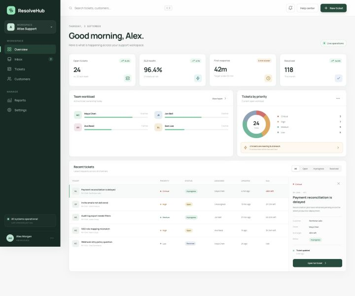
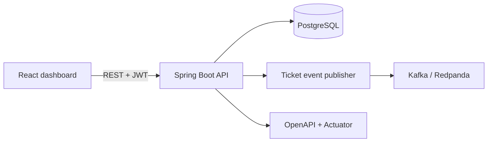

# ResolveHub

An enterprise-style support ticket and SLA management platform built to demonstrate production-minded Java backend engineering. ResolveHub combines a secure Spring Boot REST API, PostgreSQL persistence, event-driven ticket lifecycle events and a responsive React operations dashboard.

[](https://github.com/GKARAMOU/resolvehub/actions/workflows/ci.yml)
[](https://openjdk.org/projects/jdk/21/)
[](https://spring.io/projects/spring-boot)
[](https://react.dev/)
[](LICENSE)

**[Open the live dashboard](https://gkaramou.github.io/resolvehub/)** · **[Browse the API documentation](http://localhost:8080/docs)**



## Why this project exists

ResolveHub models a realistic B2B workflow rather than a tutorial CRUD application. It handles ticket ownership, guarded state transitions, SLA deadlines, role-based authentication, activity history and asynchronous domain events. The static live demo lets recruiters explore the dashboard immediately; the complete API and infrastructure run locally through Docker Compose.

## Features

- JWT authentication with `ADMIN`, `AGENT` and `REQUESTER` roles
- Ticket creation, search, priority filtering, assignment and comments
- Explicit workflow rules for open, active, waiting, resolved and closed tickets
- Priority-based SLA deadlines with breach reporting
- Immutable activity timeline for ticket auditability
- Kafka-compatible lifecycle events with a local logging fallback
- Flyway-controlled PostgreSQL schema migrations
- OpenAPI/Swagger documentation and Actuator health checks
- Responsive React dashboard with search, filters, ticket details and create flow
- Unit, integration and UI tests in a GitHub Actions pipeline
- Reproducible multi-container environment with Docker Compose

## Architecture



The Java backend uses a layered package structure with domain behavior kept inside the ticket model. Database changes are versioned through Flyway, while ticket lifecycle events are published behind an interface so local development can run with or without Kafka.

## Technology

| Area | Stack |
| --- | --- |
| Backend | Java 21, Spring Boot 4, Spring Security, Spring Data JPA |
| Data | PostgreSQL 17, Flyway, H2 for tests |
| Messaging | Spring Kafka, Redpanda |
| API | REST, JWT, OpenAPI/Swagger, RFC 9457 problem details |
| Frontend | React 19, TypeScript, Vite 8, responsive CSS |
| Quality | JUnit 5, AssertJ, Vitest, Testing Library, Oxlint |
| Delivery | Docker, Docker Compose, GitHub Actions, GitHub Pages |

## Run the full stack

Requirements: Docker Desktop with Docker Compose.

```bash
cp .env.example .env
# Replace JWT_SECRET in .env with a strong Base64 value.
docker compose up --build
```

Then open:

- Dashboard: `http://localhost:3000`
- API documentation: `http://localhost:8080/docs`
- Health endpoint: `http://localhost:8080/actuator/health`

Stop the stack with `docker compose down`. Add `-v` only when you also want to delete the local PostgreSQL volume.

## Run without Docker

Start PostgreSQL locally and use the default database values from `application.yml`, then run:

```bash
cd backend
./mvnw spring-boot:run
```

In a second terminal:

```bash
cd frontend
npm install
npm run dev
```

Kafka is disabled by default outside Docker. Enable it with `KAFKA_ENABLED=true` and set `KAFKA_BOOTSTRAP_SERVERS` when a broker is available.

## Demo API account

Local startup seeds example data when the database is empty.

```text
Email: admin@resolvehub.example
Password: ResolveHubDemo!2026
```

Get a token:

```bash
curl -s http://localhost:8080/api/auth/login \
  -H 'Content-Type: application/json' \
  -d '{"email":"admin@resolvehub.example","password":"ResolveHubDemo!2026"}'
```

Use the returned token for protected endpoints:

```bash
curl http://localhost:8080/api/tickets \
  -H "Authorization: Bearer YOUR_ACCESS_TOKEN"
```

## Tests and quality checks

```bash
cd backend
./mvnw verify

cd ../frontend
npm install
npm run lint
npm test
npm run build
```

Every push and pull request runs backend tests, frontend lint/tests/build and both container builds. The dashboard is deployed to GitHub Pages after changes reach `main`.

## Configuration

| Variable | Default | Purpose |
| --- | --- | --- |
| `DATABASE_URL` | `jdbc:postgresql://localhost:5432/resolvehub` | JDBC connection URL |
| `DATABASE_USER` | `resolvehub` | Database username |
| `DATABASE_PASSWORD` | `resolvehub` | Database password |
| `JWT_SECRET` | development-only value | Base64 HMAC signing secret |
| `KAFKA_ENABLED` | `false` | Publish events to Kafka when enabled |
| `KAFKA_BOOTSTRAP_SERVERS` | `localhost:9092` | Kafka broker list |
| `CORS_ALLOWED_ORIGIN` | `http://localhost:5173` | Allowed dashboard origin |
| `DEMO_DATA_ENABLED` | `true` | Seed local demonstration records |

The checked-in JWT value and demo credentials are strictly for local development. Supply secrets through environment variables and disable demo data in any real deployment.

## Repository layout

```text
resolvehub/
├── backend/              Spring Boot REST API and database migrations
├── frontend/             React/TypeScript operations dashboard
├── docs/                 Repository screenshots
├── .github/workflows/    CI and GitHub Pages deployment
└── docker-compose.yml    PostgreSQL, Redpanda, API and dashboard
```

## Roadmap

- Connect the hosted dashboard to a managed API environment
- Add refresh-token rotation and account recovery
- Add WebSocket notifications for real-time ticket updates
- Add Testcontainers coverage for PostgreSQL and Kafka integration

## License

Licensed under the [MIT License](LICENSE).
